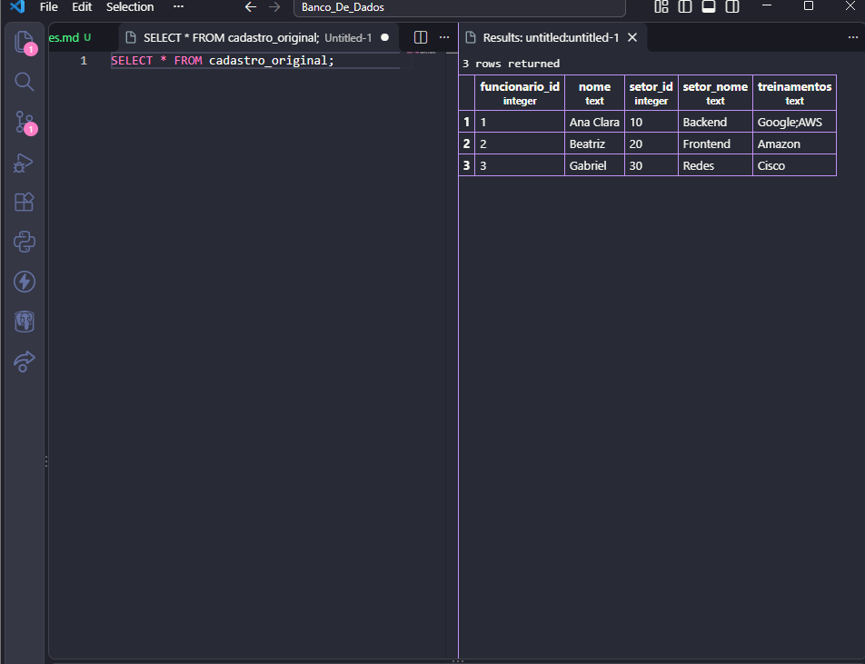
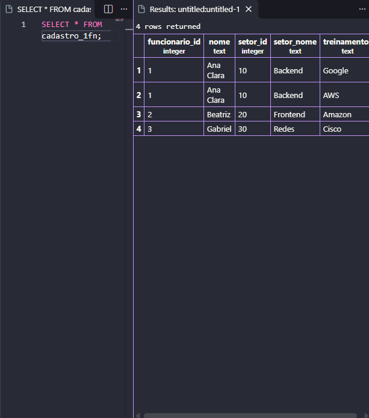
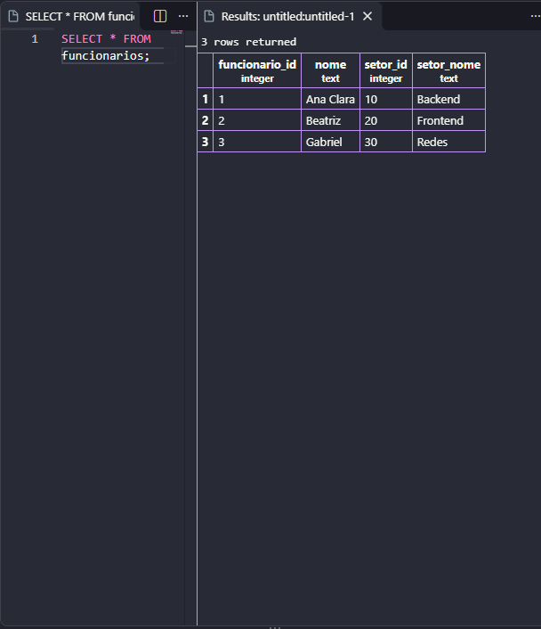

## Normalização de bancos de dados


### 1FN
1-primeiro Criamos a tabela

```sql
CREATE TABLE cadastro_original(
    funcionario_id INTEGER PRIMARY KEY,
    nome TEXT,
    setor_id INTEGER,
    setor_nome TEXT,
    treinamentos TEXT
);
```


2- Inserismos od dados na tabela:
```sql
INSERT INTO cadastro_original VALUES 
(1,'Ana Clara',10,'Backend','Google;AWS'),
(2,'Beatriz',20,'Frontend','Amazon'),
(3,'Gabriel',30,'Redes','Cisco');
```


3-Criamos uma cópia da primeira tabela, aplicando a 1FN:
```sql
CREATE TABLE cadastro_1fn AS 
SELECT funcionario_id,nome,setor_id,setor_nome, string_to_table(treinamentos,';') AS treinamentos
FROM cadastro_original;
```


4- Adicionando uma chave primária:
```sql
ALTER TABLE cadastro_1fn
ADD PRIMARY KEY (funcionario_id,treinamentos);
```


### 2FN
1- Separamos uma tabela para os funcionários;
```sql
CREATE TABLE funcionarios AS
SELECT  DISTINCT funcionario_id,nome,setor_id,setor_nome
FROM cadastro_1fn;
```

2-Adicionamos uma PK
```sql
ALTER TABLE funcionarios
ADD PRIMARY KEY (funcionario_id);
```


3-Criamos uma tabela de participacoes:
```sql
CREATE TABLE participacoes AS 
SELECT funcionario_id,treinamentos
FROM cadastro_1fn;


ALTER TABLE participacoes
ADD PRIMARY KEY (funcionario_id,treinamentos);
```


4-Adicionamos uma chave estrangeira:
```sql
ALTER TABLE participacoes
ADD FOREIGN KEY (funcionario_id) REFERENCES funcionarios(funcionario_id);
```
